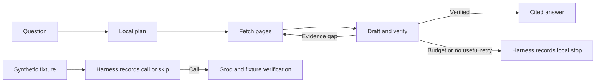

# Drishti Evidence Guard

A local-first document Q&A prototype with a bounded SLM loop, page-level citations,
and a metered escalation harness. Confidential documents stay local. The optional
Groq comparison sends only built-in fictional examples.

## Reproduce

Install Python 3.12 and [uv](https://docs.astral.sh/uv/). From the repository root:

```sh
uv sync --locked --python 3.12
uv run --locked ruff check src tests
uv run --locked pytest
uv build
```

Keep the source PDF, GGUF weights, extracted index, credentials and run database
outside Git checkouts. Use an approved local copy of the PDF, without changing the
original. The repository ships no report, report-derived fixtures, or model weights.
Point `--data-dir` to a private local directory on a non-shared drive.

For PDF questions, start a [llama.cpp](https://github.com/ggml-org/llama.cpp/releases)
server on loopback with an instruction-tuned GGUF. The Windows smoke test uses
build `b6760` and
[Qwen2.5 1.5B Instruct Q4_K_M](https://huggingface.co/Qwen/Qwen2.5-1.5B-Instruct-GGUF/tree/91cad51170dc346986eccefdc2dd33a9da36ead9).
Download the GGUF from that revision into an external directory. Its SHA-256 is
`6a1a2eb6d15622bf3c96857206351ba97e1af16c30d7a74ee38970e434e9407e`.

```sh
llama-server -m "PATH_TO_EXTERNAL_GGUF" --host 127.0.0.1 --port 8080 -c 8192 -np 1 --alias qwen2.5-1.5b
uv run --locked evidence-guard --data-dir "EXTERNAL_PRIVATE_DIR" ask --pdf "EXTERNAL_REPORT.pdf"
```

The commands are the same on macOS/Linux and Windows, using `llama-server.exe`
on Windows. The local adapter rejects remote hosts and redirects. Ask prompts
interactively when the question should stay out of shell history. The output and
the extracted index can contain confidential excerpts, so keep both local.

To use the browser interface, keep the model server running and start:

```sh
uv run --locked evidence-guard --data-dir "EXTERNAL_PRIVATE_DIR" ui --pdf "EXTERNAL_REPORT.pdf"
```

Open [the local console](http://127.0.0.1:8787/). Ask a question and select its
entry in Route history to inspect the answer, source excerpt, fetch timings,
and the reason for calling or skipping Groq. The question list lives in the
current tab. The external SQLite database keeps the metadata after the tab closes.
Agent activity updates during a search. Planner, retriever, context, writer,
verifier and router cards show the action, status, operational reason, evidence
page IDs and elapsed time. These are sequential workflow roles sharing the local
model. Selecting an earlier run shows its last recorded state for each role.
Activity explanations come from explicit workflow decisions and validation results.
The events stream to the browser as they are persisted in the external database.
Model and time-limit failures have a separate local-error outcome.
The synthetic demo runs offline by default. To show the live synthetic demo
button, start with `--enable-live-demo` and set `GROQ_API_KEY` in the server's
environment. That button submits only the built-in fictional examples.



Context engineering preserves layout text, page numbers, a document fingerprint,
and the exact evidence sent to the SLM. Loop engineering tries the original
question, a requirement query, and adjacent pages within a local time budget.
Harness engineering enforces input paths, loopback, citations, the model output
contract, and the outbound boundary. Code resolves cited excerpt IDs and checks
numeric values before a separate semantic verification pass. Unresolved answers are marked
partial or insufficient. The prototype handles text PDFs. Scanned pages, chart
image interpretation, and human-grade verification are outside this release.

## Meter escalation and project cost

The scripted fixture shows a local lookup, a cross-section escalation, and a
missing fact. It uses a fixed answer key to check the hosted answer. Offline mode
is the default. It exercises the decision trace without making any API requests.

```sh
uv run --locked evidence-guard --data-dir "EXTERNAL_PRIVATE_DIR" demo
```

Set `GROQ_API_KEY` from your local secret store, then run both live modes on the
same synthetic cases into a fresh external data directory for each comparison.
Live calls can incur charges.

```sh
uv run --locked evidence-guard --data-dir "EXTERNAL_SAMPLE_DIR" demo --mode cascade --live
uv run --locked evidence-guard --data-dir "EXTERNAL_SAMPLE_DIR" demo --mode baseline --live
uv run --locked evidence-guard --data-dir "EXTERNAL_SAMPLE_DIR" report --monthly-questions 100000 --expected-frontier-rate 0.10 --local-cost-per-question 0.00001
```

SQLite records the trace ID, route and reason, elapsed time to the route decision,
fetch attempts and duration, first verified evidence, model timings, and end-to-end
time. The harness persists a frontier attempt before dispatch, then records status,
request ID, prompt/output/cached tokens and estimated list cost when available.
The database stores metadata without prompt, excerpt, answer or credential text.
Incomplete usage is surfaced separately, and an unknown charge never counts as a
free call in the projection.

The report prices measured token usage using the public
[Groq model card](https://console.groq.com/docs/model/openai/gpt-oss-120b) rate
snapshot from 2026-11-06. It estimates all-frontier cost as volume times mean
baseline call cost. Cascade cost uses volume times the assumed escalation rate
times mean cascade call cost. Net savings subtract the provided local cost per
question. Use a representative, approved workload to estimate escalation rates,
quality, and local costs before treating the projection as a business case.
The three fictional cases validate the measurement path and do not benchmark
accuracy, escalation rates, or production performance.
