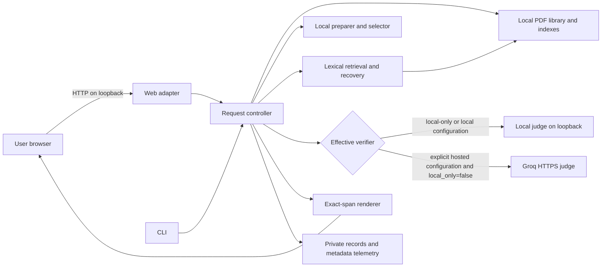
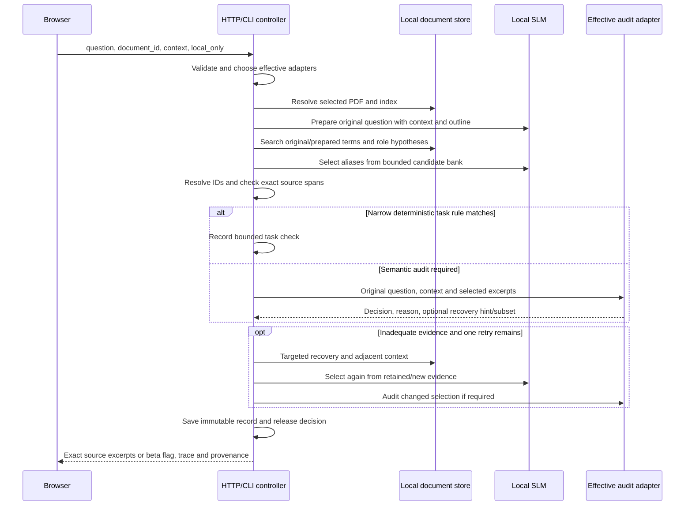
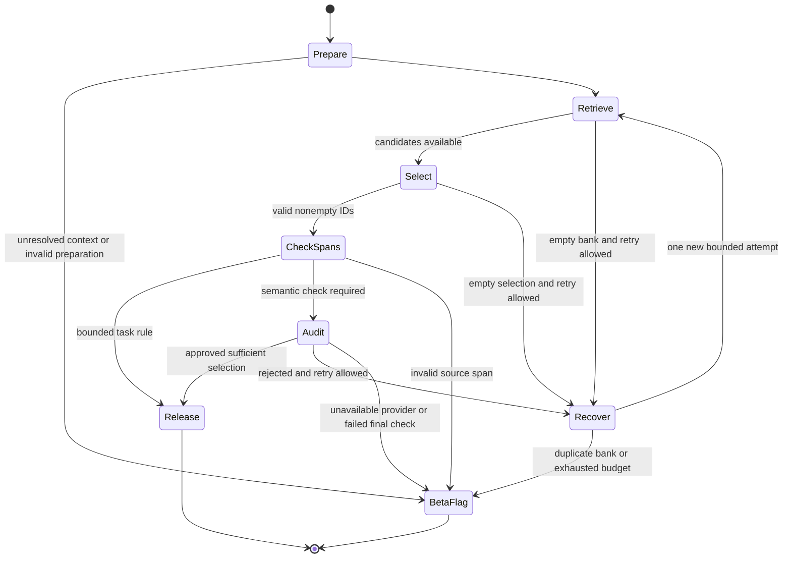

# Technical implementation: Drishti Evidence Guard

| Field | Value |
| --- | --- |
| Document status | Implemented-system description, with explicit gaps |
| Application baseline | 0.11.0 beta |
| Answer contract | `source-selection-v1` |
| Retrieval record protocol | `relationship-retrieval-v1` |
| Hosted audit cache protocol | `groq-audit-v1` |
| Intended deployment | Single-user loopback service and external local model servers |
| Primary implementation | Python package with a vanilla JavaScript browser interface |

This document follows conventional software-design practices: numbered requirements,
component and sequence views, contracts, data ownership, trust boundaries, failure
analysis, testing and operational procedures. It is not a certification of security,
semantic accuracy, regulatory compliance or production readiness. Source code is the
authority if behavior differs from this document.

## 1. Purpose, scope and quality objectives

The system answers a request against one explicitly selected searchable PDF. A small
local model prepares the search and chooses source IDs. Application code controls
retrieval, validates source spans and renders original text. A configurable judge
assesses whether the selected excerpts answer the original request.

The design separates three properties:

1. **Provenance:** text belongs to the selected PDF and its exact extracted span.
2. **Semantic adequacy:** text answers the requested role, subject, parts and scope.
3. **Operational availability:** extraction and model/provider calls finish within
   configured limits.

Provenance is mechanically checked. Semantic adequacy remains fallible even when
models agree. A correct refusal prevents unsupported release; it is still a task
failure when adequate evidence existed in the document.

### 1.1 Requirements and traceability

| ID | Requirement | Implementation | Verification |
| --- | --- | --- | --- |
| FR-01 | Upload/select a PDF before searching; bind every result to that document | `DocumentStore`, web request validation, CLI request closure | `test_documents.py`, `test_web_documents.py` |
| FR-02 | Preserve the original question and explicit context | Extractive planner payload; harness-owned requirements | `test_extractive.py`, relationship/scope tests |
| FR-03 | Display only application-copied original source spans | Immutable source IDs, `render()` | Source-span and forged-ID tests |
| FR-04 | Assess original requested role and qualifications | Selector and verifier instructions; original question in both calls | Synthetic role contrasts and model-adapter contract tests |
| FR-05 | Permit one bounded evidence recovery | Extractive controller, retained/new candidate bank | Empty-selection, rejected-audit, retention and retry-bound tests |
| FR-06 | Allow explicit hosted judging without hosted selection | Groq adapter, CLI role restrictions | Hosted-role and subset tests |
| FR-07 | Allow confidential local-only requests without hosted fallback | Strict `local_only` flag, local verifier override | CLI integration, HTTP validation, local-failure tests |
| FR-08 | Preserve failures and original model-call evidence | Exclusive-create JSON records; review packet | Record/isolation tests and release evidence |
| NFR-01 | Bound request, source-context and model work | Upload/request limits, evidence bank and time budgets | Boundary/timeout tests |
| NFR-02 | Keep document runtime state out of Git | Path boundary checks, ignore rules, publication audit | Storage tests and public-tree scan |
| NFR-03 | Reproduce builds and explain operational outcomes | `uv.lock`, source/document digests, trace metadata | CI, build checks, evaluation manifests |

### 1.2 Explicit exclusions

The current release does not provide OCR, robust arbitrary-layout reconstruction,
visual figure understanding, a multi-user permission model, cloud document storage,
cross-document answering or independently calibrated semantic correctness. It is a
bounded sequential pipeline, not a multi-agent orchestration system. It does not
download or supervise local model processes.

## 2. Architecture and deployment boundaries



| Component | Code | Responsibility and boundary |
| --- | --- | --- |
| Composition root | `src/evidence_guard/cli.py` | CLI parsing, adapter construction, document binding, effective provider, immutable final record |
| HTTP adapter | `web.py` | Loopback server, origin/host validation, uploads, streamed searches, static assets |
| Document library | `documents.py` | Content-addressed files, bounded upload validation, metadata, two-entry index cache |
| Source pipeline | `extractive.py` | Content-stream extraction, source IDs, strict schemas, prepare/select/audit/recover/release |
| Search vocabulary | `retrieval.py` | Search-only spelling/filler normalization, bounded relationships, match metadata |
| Lexical index | `evidence.py` | Stemming, BM25-style ranking and reciprocal-rank fusion |
| Local adapter | `models.py` | Loopback-only endpoint validation, JSON requests, sanitized failures |
| Hosted adapter | `groq_verifier.py` | Fixed provider endpoint, credential order, state lock, cooldowns, daily attempts and cache |
| Artifact/telemetry helpers | `working.py`, `telemetry.py`, `evaluation.py` | Strict validation, exclusive records, SQLite events and source fingerprinting |
| Browser UI | `static/index.html`, `app.js`, `app.css` | Document selection, confidentiality flag, live activity, source/page links, review packet |
| Compatibility workflows | `workflow.py`, `adaptive.py`, `understanding.py`, `working.py` | Dispatch and retained diagnostic workflows; not equivalent to the extractive contract |

The server binds to `127.0.0.1`. Local adapters accept an HTTP loopback `/v1` base
URL without credentials, query or fragment. The request transport disables proxies
and redirects. The hosted verifier uses a fixed Groq HTTPS endpoint. This is a
deployment boundary, not an operating-system sandbox or a substitute for access
control on a shared machine.

### 2.1 Normal request sequence



## 3. Ingestion and source identity

### 3.1 Upload processing

`POST /api/documents` accepts raw PDF bytes rather than multipart content. The
service checks content type, byte length, filename suffix, PDF header, parseability,
encryption status and page count. The filename is reduced to a bounded basename;
it never determines the storage path. Upload and search share a nonblocking busy
lock, so concurrent operations receive a conflict rather than running redundant
model work.

The SHA-256 of the PDF bytes becomes the document ID. The library writes
`documents/<sha256>.pdf` and a separate JSON metadata file under the external data
directory. Duplicate uploads select the existing document. Failed uploads do not
replace the valid library. Stored PDF serving rechecks its hash. Index loading
also compares the extracted fingerprint with the selected document ID.

| Limit | Implemented value |
| --- | ---: |
| Upload | 25 MiB |
| PDF pages | 500 |
| Extracted text accepted by upload indexing | 10,000,000 characters |
| HTTP upload socket timeout | 15 seconds |
| In-memory document indexes | 2 entries |

Wholly image-only PDFs are rejected with an OCR instruction. Partially searchable
PDFs expose their searchable/unsearchable page count. No OCR is silently invoked.
PDF parsing is performed in-process, so these limits do not constitute resource
isolation against hostile PDF files.

### 3.2 Extractive index and immutable source IDs

The active source-only workflow uses `pypdf` content-stream text extraction, separate
from the legacy layout/index cache. `pdf_index()` first verifies the document hash
and has a two-document LRU cache keyed by path and fingerprint.

`SourceIndex` divides pages at recognized headings and then creates spans targeting
at most 1,000 characters. Where possible it cuts at sentence or line boundaries.
Each passage has a page number, heading, kind and exact text. Its stable ID encodes
page, start offset, end offset and a short SHA-256 digest of the passage text:

```text
x<PAGE>-<START>-<END>-<TEXT_DIGEST>
```

Offsets are zero-based Python string character indexes into the extracted page
text, not byte positions, visual PDF coordinates or browser UTF-16 offsets. Line
breaks, hyphenation and text-layer artifacts remain intact. The renderer checks
`page.text[start:end] == passage.text` before producing a released claim.

Heading recognition supports selected numbered/Roman/letter forms and a small
explicit title set. It does not recognize every unnumbered uppercase heading;
headings can therefore carry incorrectly into later passages. Table rows and
qualifications can also split across chunks. These are documented extraction and
retrieval limitations, not guarantees solved by exact-span checking.

## 4. Query preparation and retrieval

### 4.1 Original request remains authoritative

The preparer receives the original question, user context, conversation subject
and document outline. Its strict schema requires `query`, `intent`,
`needs_clarification` and a short operational `reason`. Supported intents are
`locate`, `identify`, `explain`, `compare`, `list` and `fact`.

The harness sets `requirements = [original_question]`. A generated preparation
cannot replace the task with a narrower requirements list. Original wording,
numbers, entities, comparisons, negation and scope remain available to selection
and judging. Missing document evidence is not itself evidence of missing user
context. A narrow bare-reference guard handles some unresolved referents; the
model can separately request clarification. Neither is a complete ambiguity model.

### 4.2 Ranking and search hypotheses

The active extractive path is lexical, not hybrid. The index uses English Snowball
stems and BM25-style passage scoring with heading boosts and reduced weights for
some references/caption material. Original and prepared lexical searches are
combined with reciprocal-rank fusion. Generic optional semantic helpers elsewhere
in the package do not make this production path semantic or hybrid.

The extractive index overrides search tokenization without changing the shared
legacy token semantics. It normalizes an explicit set of organizer spelling
variants and removes a bounded set of conversational filler. For recognized
identity questions, lexical search strings remove selected question scaffolding;
the original question and source text remain unchanged.

Bounded relationship hypotheses cover organizer, sponsor, recipient, author,
publisher, owner, operator and host. Alternatives such as `run by` or `prepared
for` are matched as phrases, avoiding loose fragment hits on unrelated preparation
or running activity. Candidate phrase hits are ranked using original-question
content overlap. Alternatives are capped at six. A host, sponsor or operator is
not automatically the organizer; the original relationship must still pass audit.

For recognized section-navigation or existence wording, matching actual section
headings and continuations receive priority. Document-purpose and identity
questions can receive bounded first-page context. Context-only passages are
diagnostic candidates, not proof of a requested fact.

| Retrieval/selection bound | Value |
| --- | ---: |
| Fused ranking request | 12 passage candidates |
| Final model-visible bank | At most 6 passages / 4,800 characters |
| Selected IDs | At most 3 |
| Selection rounds | At most 2 total |

Private review records include original/prepared searches, relationship
alternatives, content/prepared/relationship matches, context-only signals,
retained/new IDs and recovery provenance. They must not be copied to public
telemetry or source control.

## 5. Selection, validation and release controller

Models see short aliases such as `s1`; only the harness maps aliases to immutable
source IDs. The selection schema enumerates the current bank's aliases. Unknown
IDs, malformed output and extra properties fail validation. Model-written reasons
are operational notes, never displayed answer text.

Two narrow deterministic task checks can bypass semantic model judging:

- Recognized section-location or supported positive-existence wording with actual
  matching section anchors and headings.
- One explicit positive duration statement for the same subject in the supported
  `How long is ...?` form, without a defined set of negation/dispute indicators.

These are bounded rules, not general semantic proofs. Other selections go to the
effective verifier. Local audits return `accept`, `insufficient` or `irrelevant`,
a reason and a recovery query. Hosted audits additionally choose 1-based string
indices for the smallest sufficient approved subset. An accepted empty hosted
subset fails closed.

### 5.1 Recovery and duplicate handling

The application owns recovery. Empty candidate banks, empty selected IDs and
rejected audits can trigger one retry if at least 25 seconds remain. A nonempty
judge hint is combined with the original question. Without a hint, the controller
retains the validated preparation and adds adjacent source context.

Selected witnesses can be retained before fresh candidates, within the same
six-passage/4,800-character limits. Candidate-bank identity is compared as a set of
source IDs; a repeated bank stops before another identical selection action. The
records distinguish retry exhaustion, time-budget stopping, repeated banks,
provider errors, bounded-rule approval and judged approval.

Retained weak evidence can still crowd out fresh passages. A changed candidate
bank can also produce the same rejected selected IDs again, causing redundant
judging or a hosted cache hit. These are known controller limitations. Recovery
does not guarantee the needed witness will be seen or selected.

### 5.2 Release states



Released results use `route="source_excerpt"`, populated `claims` and exact-source
verification metadata. Unreleased results use `route="beta_flag"`, empty released
claims, a concrete reason/detail and optionally separate `review_excerpts`.
Neither beta flags nor genuine quotations alone establish document-wide absence.

## 6. Provider selection and confidential mode

### 6.1 Effective adapter decision

| Server configuration | Request | Selector | Verifier | Groq permitted for that search |
| --- | --- | --- | --- | --- |
| Local | Default | Configured local answer model | Configured local verifier | No |
| Local | Reversed local roles | Configured local verifier | Configured local answer model | No |
| Groq-enabled extractive | `local_only=false` or absent | Local answer model | Configured Groq judge | Yes |
| Groq-enabled extractive | `local_only=true` | Local answer model | Retained configured local verifier | No |

Hosted configuration requires the extractive workflow and primary roles. Hosted
judging cannot be reversed into hosted source selection. Confidential local-only
override is rejected for unsupported workflows. A strict boolean check rejects
strings, integers, null, arrays and objects rather than coercing them to a provider
choice.

The local-only request bypasses the Groq adapter, including its successful-response
cache. Local failures produce local/beta failure results; they do not cause a
hosted fallback. Local endpoints remain subject to loopback validation.

### 6.2 UI state and audit behavior

The checkbox is available in a Groq-enabled extractive console with a configured
local verifier. It changes the visible model labels and data-transfer disclosure.
It is disabled while a search is in progress so the submitted choice cannot be
misrepresented by a later toggle during the same request.

The preference is remembered in browser `sessionStorage`, survives reload and
document switches in that tab, and is not permanent document metadata or a shared
preference across tabs. Selecting local-only does not retract earlier hosted
transmissions. The application does not infer confidentiality from document text.

The disclaimer states that local verification may be less reliable than the larger
Groq verifier, may miss errors or reject valid evidence, and requires source review.
Completed results and exported review packets record the actual provider and
model identities independently of the checkbox's later state. Record fields
include `local_only`, `verification_provider`, `verification_notice` and
`model_roles`.

### 6.3 Hosted transport, quotas and cache

`GroqVerifier` reads explicitly named key files in place. It validates their
formats, rejects duplicate key values, stores hashed credential identities in
runtime state and exposes ordinal credential labels, not key values. These labels
do not prove separate provider organizations or independent allowances.

The fixed HTTPS request uses temperature zero, low reasoning effort, a strict
JSON schema and a 1,024-token completion allowance including reasoning. The result
is validated again locally. Redirects and environment proxy forwarding are
disabled. Provider error bodies are not included in user-visible failures.

| Condition | Behavior |
| --- | --- |
| HTTP 429 | Honor Retry-After/applicable reset cooldown; try next available credential |
| HTTP 401/403 | Disable that credential in runtime state; try next available credential |
| HTTP 5xx | Short cooldown; try next available credential |
| Other HTTP error | Sanitized failure; no automatic approval |
| Timeout, truncation, invalid JSON/schema/state | Specific fail-closed error |
| Exhausted configured daily attempt budget | Stop; do not wait for quota reset |

A nonblocking cross-process state-file lock serializes quota/cache updates. JSON
state replacement uses a temporary file followed by replace. The default budget is
200 network attempts per UTC day, across credentials sharing a runtime directory.
It is not a token/cost guarantee. Different data directories have different
application counters; provider-side quotas still apply.

Successful exact audit requests cache for 24 hours. The key includes model,
instruction, payload with document digest, schema and protocol. Cache hits record
zero network calls and zero billed-token usage in trace accounting; they remain
prior hosted assessments. Invalid/failed outputs never cache as approval. Raw cache
entries contain document excerpts and must remain private. Disabling/replacing a
credential requires deliberate external-state maintenance; no reset-wait loop or
quota-burning test is implemented.

## 7. HTTP interface and schemas

The server is an internal loopback API, not a public web service. It validates the
exact Host authority on reads and both Host and Origin on mutations. Responses
disable caching/sniffing and set a restrictive content-security policy. It does not
implement sessions, authentication or a remote reverse-proxy trust model.

| Endpoint | Method and body | Success | Failure examples |
| --- | --- | --- | --- |
| `/` | GET | Console HTML | 403 wrong Host |
| `/app.js`, `/app.css` | GET | Bundled static assets | 404 unknown path |
| `/api/config` | GET | Version, contract, library, model roles and provider capability/disclaimer | 403 wrong Host |
| `/api/documents` | GET | Library metadata and default ID | Library unavailable outside document-console mode |
| `/api/documents?name=example.pdf` | POST, `application/pdf`, raw bytes | Document metadata, duplicate flag and index timing | 413 oversize, 415 type, 422 invalid/unsearchable PDF, 409 busy |
| `/api/document?document_id=<sha256>` | GET | Original PDF bytes; client appends `#page=N` | 404 invalid/missing/changed document |
| `/api/search` | POST, `application/json` | NDJSON events and one final result | 400 validation, 403 origin/host, 409 busy, streamed run failure |
| `/api/demo` | POST, JSON `live` flag | Synthetic demo records | Live mode disabled unless explicitly configured |

### 7.1 Search request

```json
{
  "question": "Who is the recipient of this protocol?",
  "document_id": "aaaaaaaaaaaaaaaaaaaaaaaaaaaaaaaaaaaaaaaaaaaaaaaaaaaaaaaaaaaaaaaa",
  "topic": null,
  "context": null,
  "role_assignment": "primary",
  "local_only": true
}
```

The digest above is a shape example, not a real library ID. A request must refer
to an uploaded document. Question length is 1-1,500 characters after trimming;
optional context is 1-3,000 characters; optional topic is 1-120 characters. The
JSON request body limit is 8,192 bytes. Unicode-heavy text can hit this byte limit
before the character limits. Role assignment must be configured and one of
`primary`/`reversed`. `local_only` defaults to false and must be a JSON boolean.
The parser validates selected fields but does not enforce a closed top-level
request-object schema.

### 7.2 Streaming protocol

Each UTF-8 line is a JSON object:

```json
{"type":"event","event":{"kind":"activity","role":"retriever","status":"completed","trace_id":"example"}}
{"type":"result","result":{"route":"beta_flag","claims":[],"local_only":true,"verification_provider":"local","reason":"evidence_not_established"}}
```

These are abbreviated shape examples. A server-side run exception can emit
`{"type":"error","error":"Run failed. Check the local model."}`. The browser
incrementally decodes lines and treats a closed connection without a final result
as an incomplete run. Client disconnects stop emitting to that client but do not
cancel model computation. This is an operational limitation, not reliable job
cancellation.

### 7.3 Internal model schemas

All model output objects have required fields and forbid additional properties.
String and array bounds are enforced by the small application validator as well
as the requested provider schema. The validator supports the specific schema
subset used by this project; it is not a general JSON Schema implementation.

| Stage | Required output | Additional constraint |
| --- | --- | --- |
| Prepare | `query`, `intent`, `needs_clarification`, `reason` | Prepared query <=220 chars; bounded intent enumeration |
| Select | `ids`, `reason` | <=3 aliases, restricted to supplied candidate bank |
| Local audit | `decision`, `reason`, `recovery_query` | Decision enumeration; recovery query <=180 chars |
| Hosted audit | Local audit fields plus `passage_indices` | <=3 indices restricted to selected passage count; nonempty on accepted release |

## 8. Data ownership, records and reproducibility

```text
EXTERNAL_PRIVATE_DIR/
  documents/
    <document-sha256>.pdf
    <document-sha256>.json
    indexes/...
  query-records/<trace-id>.json
  extractive-calls/<trace-id>-NN.json
  groq-verifier/
    state.lock
    state.json
    cache/<request-sha256>.json
  telemetry.sqlite
  evaluations/...
```

`outside_repository()` resolves a path and checks its ancestry for Git checkout
markers. PDFs, runtime state and model/semantic caches supplied through protected
paths must remain outside Git. Explicitly named Groq key-file inputs are read in
place; this is not permission to copy credentials into the checkout.

| Data | Sensitivity | Persistence and retention |
| --- | --- | --- |
| PDF bytes/extracted text | Confidential input | External library/indexes; no automatic document retention policy |
| Original question/context and raw calls | Potentially confidential | External immutable JSON; retain failures alongside later successes |
| Query record | Document/source identities, selected text, prompts, errors and result | Exclusive-create file; returned record SHA-256 |
| SQLite events | Operational metadata | Timings, actions, model/provider outcomes and usage; not a second raw-prompt store |
| Hosted cache | Selected excerpts, question/context and assessment | Exact successful request cache; 24-hour logical expiry; external directory |
| Credential files | Secret | Explicit paths outside publication; never emitted to records or Git |
| Model weights | External dependency | Not bundled, downloaded or deleted by application startup |

Call records are saved in a `finally` block even when parsing/transport fails. The
final query record is created with exclusive file creation (`xb`) and records its
SHA-256. This prevents normal accidental overwrite; it is not WORM storage,
cryptographic signing, encrypted storage or protection against a local administrator.

The source fingerprint covers Python/JS/CSS/HTML file paths and bytes under the
package. It excludes README, tests, dependencies and runtime files. Path separator
and line-ending differences can change it across platforms or Git archives. It is
a source identity signal, not a universal reproducible-build digest. Pair it with
the commit, lockfile, platform/dependency metadata, model identity/configuration,
document hash and immutable evaluation manifest.

Raw records can include server aliases rather than independently verified model
weight hashes. Operators must separately preserve model-file hashes and actual
server configuration for controlled evaluations. Do not infer model identity or
independent correctness from endpoint aliases alone.

## 9. Security and privacy threat model

| Threat | Implemented control | Residual gap |
| --- | --- | --- |
| Cross-document substitution/path traversal | Explicit validated digest IDs, content-addressed storage and hash checks | Local filesystem modification remains outside the app's trust boundary |
| Browser cross-origin mutation | Exact Origin and Host checks; loopback bind; bounded request bodies | No user authentication; another local process can send requests |
| Source/context prompt injection | Data/instruction separation, strict ID/schema constraints, application-owned release | Models may still select instructions or reject valid witnesses |
| Fabricated displayed answer | IDs only; exact page-span renderer | Genuine text can still be irrelevant, incomplete or misunderstood |
| Accidental hosted transfer | Explicit provider configuration, disclosure, strict local-only override and no fallback | Operator must select the flag before a confidential request; not an automatic classification system |
| Secret leakage in logs/errors | Named-file credentials, sanitized provider failures, safe header allowlist | External runtime files and local backups need operator access controls |
| Quota overuse/concurrent mutation | Per-directory daily attempt counter, state lock and cooldowns | No global organization-wide or monetary cap |
| Excessive local work | Upload/body/context/round/token/time bounds and busy lock | Parsing is not isolated; time budgets are not OS-enforced cancellation |
| Publication of private material | Ignore rules, synthetic-only fixtures, public-tree/history audit | Ignore rules do not remove tracked files or sanitize Git history automatically |

Documents and raw records are not encrypted by the application. File permissions,
disk encryption, backups, retention/deletion and trusted local model services are
operator responsibilities. Do not expose the HTTP service publicly or interpret
its current headers as a production internet-facing security architecture.

Public issues, CI logs, release assets and examples must contain synthetic data
only. Never publish screenshots, query packets or benchmark datasets copied from
a private runtime. Before publication, inspect the whole reachable history, tags,
branches, release assets and metadata as well as the current tree.

## 10. Configuration and operational procedures

### 10.1 Startup

1. Install Python and the locked application environment with `uv sync --locked`.
2. Start existing compatible local model servers on loopback. Model provisioning,
   memory sizing, thread count and context windows are external responsibilities.
3. Choose a private runtime directory outside any Git checkout.
4. Start the CLI console with explicit model URLs. The CLI's default answer-model
   URL is port 8080; examples use explicit ports to avoid ambiguity.
5. Open the exact loopback URL, upload/select the PDF and confirm the provider
   disclosure before searching.

The server's synthetic startup warm-up uses local models and does not transmit
document content. Hosted-mode startup skips hosted verifier warm-up. A model
server being configured does not prove its health or guarantee loaded weights.

### 10.2 Work budgets and performance interpretation

| Budget | Current extractive behavior |
| --- | --- |
| CLI request model-work allowance | Default 120 seconds |
| Each model invocation | Smaller of 35 seconds or remaining allowance |
| Minimum remaining allowance for invocation | 2 seconds |
| Recovery eligibility | At least 25 seconds remain; at most one retry |
| Local prepare/select/audit output cap | 140 tokens per call |
| Hosted audit completion cap | 1,024 tokens including reasoning |

These are application scheduling/transport budgets. Document loading, OS scheduling,
parsing, response streaming and socket behavior can affect total observed time.
There is no hard process-level deadline or end-to-end availability SLO.

Measure model startup separately from requests to already-running servers, local
prompt-cache effects separately from hosted cache hits, and provider network calls
separately from judge invocations. Smaller prompts or cached judgments are not by
themselves evidence of better accuracy or a controlled speedup. Single-document
paraphrases are not independent evaluation samples.

### 10.3 Troubleshooting and rollback

| Symptom | Operator action |
| --- | --- |
| No searchable text | Create a local text/OCR PDF; do not expect automatic OCR |
| Wrong/empty selection | Inspect original question, preparation, candidate match signals and exact witnesses |
| Local timeout/invalid JSON | Check the specific local server's health, context/token limits and memory; retain the failure |
| Hosted pending/error | Inspect sanitized code and credential cooldown/budget metadata; do not treat as document absence |
| Local-only selected | Expect local audit quality/latency limitations; no hosted fallback is performed |
| Busy conflict | Wait for the current upload/search; do not launch redundant model processes |
| Missing/changed PDF hash | Restore the original bytes or explicitly upload the changed document |

Before replacing an installed executable on Windows, identify the loopback
listener's PID and command line, stop only that console process, install the
verified package and restart with the same external data directory. Do not kill
all Python/model processes. Rollback restores a known package/configuration while
retaining failed-run records. Back up the external library and records before
manual state maintenance; do not overwrite prior evaluation manifests.

## 11. Verification and release engineering

The 0.11.0 application baseline passed 162 automated tests on the reference local
environment. Tests cover synthetic document uploads, hash/source boundaries, strict
schemas, original-question preservation, role contrasts, recovery budgets and
retention, mocked provider failover/cache, and confidential-mode routing. This is
engineering verification, not proof of semantic accuracy over arbitrary PDFs.

CI installs locked dependencies, runs lint/format checks, executes tests without
private inputs or hosted credentials, checks JavaScript syntax, audits public
source and builds source/wheel artifacts. Use no private PDF or real credential
in CI. Optional model-backed experiments run outside this pipeline with explicitly
controlled data transfer and external evidence retention.

Release acceptance requires:

1. Clean source change review and meaningful tests for changed behavior.
2. Exact source rendering and document-isolation checks.
3. Explicit failure/no-fallback tests for confidentiality changes.
4. Paired frozen old/new development evaluations when retrieval/semantics change.
5. Separate untouched holdouts and independent label review before broad accuracy
   claims; retain disputes and all earlier failures.
6. Version/lockfile alignment, source/wheel build checks and artifact hashes.
7. Public-tree and reachable-history inspection, actual configured-secret-byte
   checks locally without printing secrets, and synthetic-only public examples.
8. Verify the pushed commit/tree, public visibility and remote CI outcome.

The publication audit accepts an external deny list so private document names,
digests, phrases and project identifiers do not have to be encoded in the public
scanner itself. Never push a private development ancestry merely because its tip
is clean. Publish an audited snapshot whose entire reachable ancestry is approved.
Preserve the original development history privately rather than deleting failure
evidence to make a public release appear clean.

## 12. Design decisions and remaining engineering work

| Decision | Rationale | Tradeoff |
| --- | --- | --- |
| Application renders exact source instead of generated answer prose | Removes model authorship from the displayed answer path | Does not solve semantic relevance, completeness or awkward extraction |
| Local preparation/selection with configurable audit | Keeps source selection local and permits a larger optional judge | Hosted mode transfers bounded confidential excerpts when explicitly enabled |
| Strict ID/schema boundaries and immutable records | Makes invalid actions rejectable and failures inspectable | More validation/recording does not independently establish correct meaning |
| Sequential bounded pipeline | Predictable call/latency/context limits on small hardware | May miss answers after the allowed recovery round |
| Runtime data outside Git | Prevents routine source publication from bundling documents | Requires deliberate backup, permissions and external-state management |
| Confidential override remains local after failure | Respects the user's selected transfer boundary | Local verifier can refuse valid evidence or miss errors |

Priority follow-up work is evidence quality: stronger short-form existence
understanding, concept-equivalent retrieval, reliable heading/table boundaries,
recovery space for new witnesses, duplicate rejected-selection handling and
distinguishing source commands from factual assertions. Each change must be
evaluated without weakening original-role, qualification or exact-span checks.

Production expansion would additionally need authentication/authorization,
tenant/data separation, durable retention policy, explicit encryption/access-control
design, parser isolation, cancellation/backpressure, structured operational alerts,
capacity testing and independent adversarial/semantic evaluation. These items are
future work; this document does not represent them as implemented.
